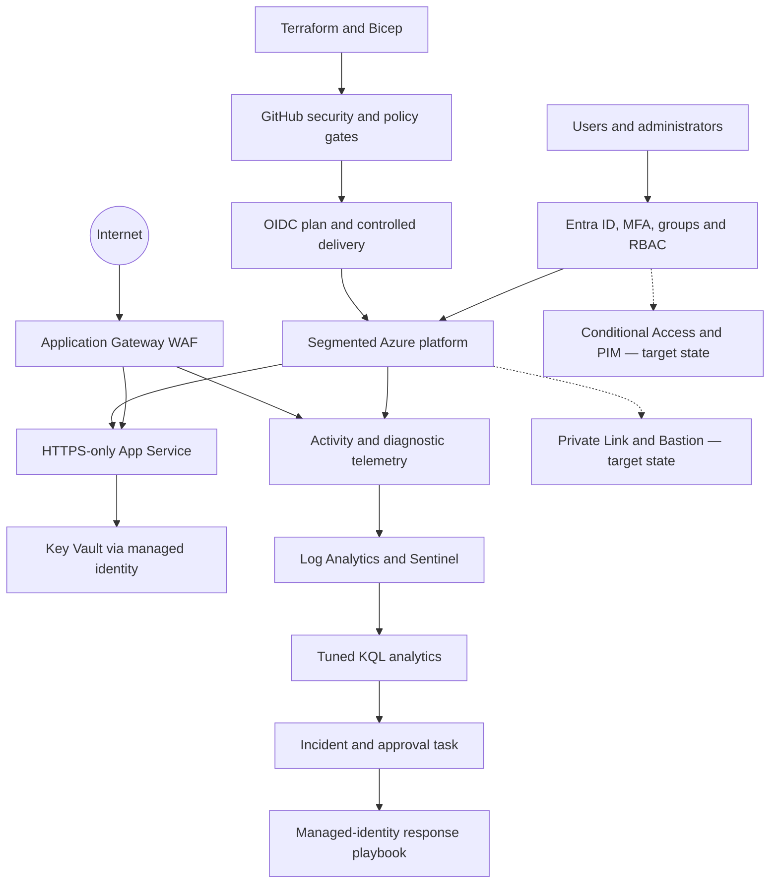

# NorthStar Enterprise Cloud Security Architecture

Enterprise Azure cloud security architecture integrating infrastructure security, Zero Trust identity, data protection, governance, security monitoring, detection engineering, and incident response.

This project is the **flagship architecture project** of the NorthStar Azure Security Portfolio. It brings together the capabilities validated across six infrastructure, identity, landing-zone, secure-delivery and security-operations projects into a unified enterprise security design.

## Architecture



**Solid paths** represent capabilities implemented or validated within the NorthStar portfolio.
**Dashed paths** represent target-state enterprise capabilities that are not claimed as deployed.

## Security Architecture

NorthStar follows a defense-in-depth model:

```text
IDENTITY
Microsoft Entra ID → MFA → RBAC / ABAC → Managed Identities
                         │
                         ▼
NETWORK
VNet → Segmentation → NSGs → Controlled Connectivity
                         │
                         ▼
DATA
Classification → Scoped Access → Encryption → Secrets Architecture
                         │
                         ▼
GOVERNANCE
Azure Policy → Guardrails → Compliance → Infrastructure as Code
                         │
                         ▼
DETECT
Activity Log → Log Analytics → Sentinel → KQL Analytics
                         │
                         ▼
RESPOND
Alert → Incident → Investigation → Classification → Resolution
```

## Core Security Domains

| Domain | Architecture |
|---|---|
| Identity & Access | Microsoft Entra ID, MFA, security groups, RBAC, ABAC, managed identities |
| Network Security | Segmented VNet, NSGs, Application Gateway WAF, controlled connectivity |
| Workload & Data | HTTPS-only App Service, Key Vault, classification, encryption and delegated access |
| Governance & Delivery | Azure Policy, Terraform/Bicep, protected PRs, Checkov, policy-as-code and OIDC |
| Security Operations | Activity Log, WAF diagnostics, Log Analytics, Sentinel and tuned KQL |
| Incident Response | Investigation, classification, approval automation and managed-identity playbook |

## Zero Trust

The architecture applies three core Zero Trust principles:

### Verify Explicitly

Authentication and authorization are evaluated through Microsoft Entra ID, MFA, RBAC, and ABAC rather than assuming trust based on network location.

### Use Least Privilege

Human and workload identities receive only the permissions required for their responsibilities and resource scope.

### Assume Breach

Network segmentation, centralized telemetry, detection engineering, incident investigation, and response provide additional security when preventive controls fail or are bypassed.

## Threat Model

The NorthStar threat model evaluates attack paths involving:

- Compromised identities
- Excessive privilege
- Internet-facing workloads
- Credential and secret exposure
- Security-control tampering
- Unauthorized data access
- CI/CD or federated-identity compromise
- Unauthorized or unsafe response automation

Each scenario is mapped to preventive, detective, and responsive controls.

See [Enterprise Threat Model](docs/threat-model/enterprise-threat-model.md).

## Security Controls

NorthStar explicitly distinguishes **validated controls** from **target-state architecture**.

Validated capabilities include:

- Microsoft Entra ID
- MFA / Security Defaults
- Azure RBAC and ABAC
- Managed identities
- Azure VNet and NSGs
- Application Gateway WAF
- HTTPS-only App Service
- Azure Key Vault with scoped managed-identity access
- Azure Policy
- Data classification
- Azure Bicep and Terraform
- Protected pull-request security gates
- Passwordless GitHub Actions OIDC
- Azure Activity Log
- Application Gateway diagnostics
- Log Analytics
- Microsoft Sentinel
- KQL detection engineering
- Scheduled analytics
- Security alert and incident investigation
- Operational-state drift validation
- Approval-gated Sentinel automation
- Managed-identity Logic App response execution

Target-state capabilities include:

- Conditional Access
- Privileged Identity Management
- Azure Bastion
- Private Endpoints / Private Link
- Risk-based identity protection and automated access reviews
- WAF Prevention mode following tuning and rollback validation
- Automated certificate renewal
- Broader Entra, endpoint, application and Defender telemetry
- Destructive containment actions behind protected approval

See [Security Controls Matrix](docs/security-controls/security-controls-matrix.md).

## Governance

NorthStar uses centralized governance to establish consistent security requirements.

A mandatory `DataClassification=Internal` Azure Policy was validated by intentionally attempting a noncompliant resource operation and confirming that Azure denied the operation until the required classification was supplied. The landing zone also validates policy-based metadata requirements and protected infrastructure-as-code delivery.

The portfolio also demonstrates an important architectural lesson: governance controls require carefully designed scopes and exceptions because blanket enforcement can interfere with legitimate platform-managed security resources.

See [Governance Framework](docs/governance/governance-framework.md).

## Security Operations

The validated security-operations and response pipeline is:

```text
Azure Control-Plane and WAF Activity
          ↓
Azure Activity Log
          ↓
Subscription Diagnostic Setting
          ↓
Log Analytics
          ↓
Microsoft Sentinel
          ↓
Tuned KQL Scheduled Analytics Rule
          ↓
Security Alert
          ↓
Sentinel Incident
          ↓
Investigation and Severity Decision
          ↓
Approval Task for Medium / High
          ↓
Managed-Identity Playbook or Manual Response
          ↓
Classification and Resolution
```

A controlled Azure operation was used to generate a real control-plane failure. The event was ingested into Log Analytics, detected through KQL, converted into a Sentinel alert and incident, investigated, classified as authorized security testing, and resolved. WAF telemetry was also baselined over 30 days to replace a noisy match-all rule with a multi-signal detection. Positive and negative tests validated the approval rule, and an approved managed-identity Logic App run added an incident comment and audit label without executing destructive containment.

## Residual Risk

NorthStar recognizes that security controls reduce risk rather than eliminate it.

Residual risks include compromised authorized identities, privilege misuse, application vulnerabilities, detection gaps, certificate-lifecycle failure and delays associated with approval or manual containment.

Target-state improvements are documented for each major risk area.

See [Residual Risk Assessment](docs/threat-model/residual-risk.md).

## Architecture Decisions

Major design decisions include:

- Identity as a primary security boundary
- Group-based authorization
- Managed identities for Azure workloads
- Network segmentation
- Centralized policy governance
- Centralized security monitoring
- Analyst validation of security detections
- Clear separation between validated and target-state controls
- Protected passwordless infrastructure delivery
- Telemetry-based detection tuning
- Human approval for consequential response
- Sanitized evidence as a control output

See [Architecture Decisions & Constraints](docs/architecture/architecture-decisions.md).

## Project Documentation

### Architecture

- [Architecture Scope](docs/architecture/architecture-scope.md)
- [Security Domains](docs/architecture/security-domains.md)
- [Zero Trust Model](docs/zero-trust/zero-trust-model.md)
- [Network Security Architecture](docs/architecture/network-security-architecture.md)
- [Identity Security Architecture](docs/architecture/identity-security-architecture.md)
- [Data Security Architecture](docs/architecture/data-security-architecture.md)
- [Security Operations Architecture](docs/architecture/security-operations-architecture.md)
- [Enterprise Architecture Diagram](docs/architecture/enterprise-architecture-diagram.md)
- [Architecture Decisions & Constraints](docs/architecture/architecture-decisions.md)

### Threat & Risk

- [Enterprise Threat Model](docs/threat-model/enterprise-threat-model.md)
- [Residual Risk Assessment](docs/threat-model/residual-risk.md)

### Governance & Controls

- [Governance Framework](docs/governance/governance-framework.md)
- [Security Operating Model](docs/governance/security-operating-model.md)
- [Security Controls Matrix](docs/security-controls/security-controls-matrix.md)
- [Security Framework Crosswalk](docs/security-controls/framework-crosswalk.md)

### Strategy & Operations

- [Executive Architecture Brief](docs/executive-architecture-brief.md)
- [Completion Matrix](docs/completion-matrix.md)
- [Implementation Roadmap](docs/architecture/implementation-roadmap.md)
- [Security Continuity and Recovery](docs/business-continuity-and-recovery.md)
- [Interview Guide](docs/interview-guide.md)

### Evidence

- [NorthStar Portfolio Evidence Index](evidence/portfolio-evidence-index.md)

### Evidence

- [NorthStar Portfolio Evidence Index](evidence/portfolio-evidence-index.md)

## NorthStar Portfolio

This project represents the architecture layer of a six-project progression:

```text
Project 1
Azure Infrastructure & Troubleshooting
        ↓
Project 2
Enterprise Identity & Zero Trust
        ↓
Project 3
Security Operations & Incident Response
        ↓
Project 4
Secure Azure Landing Zone
        ↓
Project 5
Secure DevSecOps Delivery
        ↓
Project 6
Enterprise Cloud Security Architecture
```

Together, the projects demonstrate the progression:

**Build → Protect → Detect & Respond → Harden → Deliver Securely → Architect**

## Skills Demonstrated

`Azure` · `Microsoft Entra ID` · `Zero Trust` · `Azure RBAC` · `Azure ABAC` · `Managed Identities` · `Azure Networking` · `Application Gateway WAF` · `Key Vault` · `Azure Policy` · `Terraform` · `Bicep` · `GitHub Actions` · `OIDC` · `Log Analytics` · `Microsoft Sentinel` · `KQL` · `SOAR` · `Logic Apps` · `Threat Modeling` · `Cloud Governance` · `Security Architecture`

## Scope

NorthStar is a controlled portfolio environment, not a production enterprise deployment.

The project deliberately separates capabilities that were practically validated from target-state controls requiring additional licensing, cost, workload infrastructure, or production-scale implementation.
