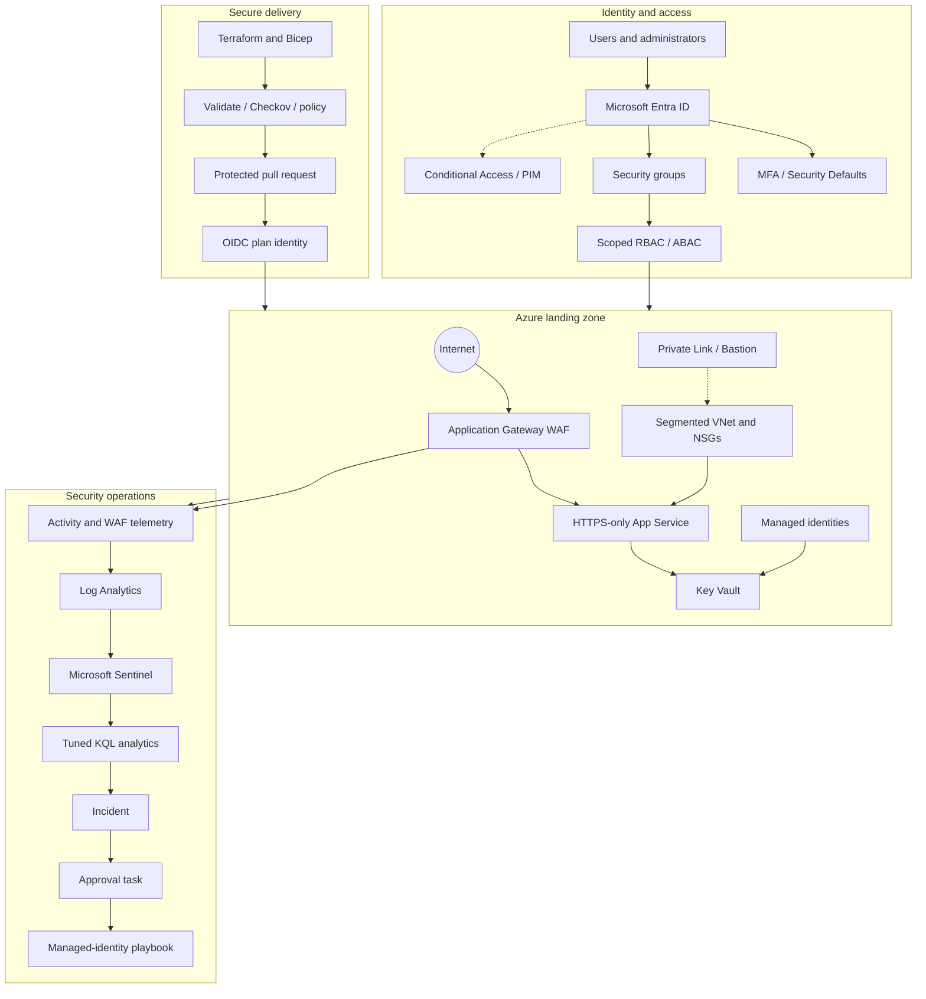

# NorthStar Enterprise Cloud Security Architecture

## Architecture Overview

The architecture combines identity, protected application delivery, governed infrastructure change, centralized monitoring and approval-gated response. Solid connections are implemented or validated; dashed connections are production target-state recommendations.



## Validated Control Path

```text
Identity and least privilege
        ↓
Segmented infrastructure and WAF
        ↓
Managed identity and Key Vault
        ↓
Policy-governed infrastructure delivery
        ↓
Centralized activity and WAF telemetry
        ↓
Tuned Sentinel detection
        ↓
Approval-gated response
        ↓
Sanitized evidence and control improvement
```

## Implemented or Validated Capabilities

- Entra users, security groups, baseline MFA and group-based RBAC;
- Azure RBAC, ABAC, managed identities and identity-lifecycle testing;
- segmented management, web, application and WAF subnets with NSGs;
- Application Gateway WAF in Detection mode and restricted App Service ingress;
- Key Vault with scoped managed-identity access and TLS certificate retrieval;
- Terraform/Bicep, protected pull requests, Checkov and policy-as-code;
- passwordless GitHub Actions OIDC using a plan-only Azure identity;
- Azure Activity and WAF telemetry in Log Analytics and Sentinel;
- tuned control-plane and WAF analytics;
- severity-based approval automation and a non-destructive Logic App; and
- live operational-state checks with sanitized JSON evidence.

## Target-State Extensions

- Conditional Access, identity risk protection and PIM;
- automated lifecycle workflows and access reviews;
- Private Link, Bastion and broader workload isolation;
- WAF Prevention mode after approved tuning and rollback testing;
- automated certificate issuance and renewal;
- broader Entra, Defender, endpoint and application telemetry;
- reversible containment actions behind protected approvals; and
- business-approved recovery objectives with tested restoration.

## Trust Boundaries

| Boundary | Required control |
|---|---|
| User to Entra | Strong authentication, device/user context and lifecycle governance |
| Internet to WAF | TLS, managed rules, request logging and tuned enforcement |
| WAF to application | Restricted backend ingress and healthy HTTPS connection |
| Application to secrets | Managed identity and vault-scoped RBAC |
| GitHub to Azure | Federated credential, protected branch and least-privilege identity |
| Azure to SOC | Diagnostic settings, retention and monitoring of control changes |
| Incident to response | Evidence, recorded approval, minimum privilege and rollback |

## Architectural Principle

NorthStar does not rely on a single security boundary. Identity determines who or what may request access, infrastructure limits reachable paths, secure delivery governs change, data controls protect sensitive material, and security operations provide detection and accountable response when prevention is insufficient.
