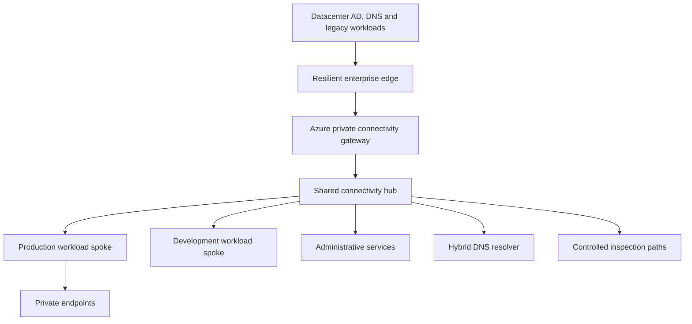

# NorthStar Hybrid Enterprise Cloud Architecture
Author: Guy Diangana | 12 October 2026 | Version 1.0
Status: Design case study; deployment and acceptance tests not executed.

## Executive brief
Design a secure transition from an assumed Canadian enterprise datacenter to Azure without disrupting AD-dependent applications. The fictional enterprise retains the 5,000 employees and 500 contractors from the IAM case study. This design extends the published NorthStar cloud and IAM architecture; it is self-directed portfolio work, not a description of Costco infrastructure.

The new evidence is hybrid connectivity selection, route and DNS control, on-premises/cloud identity dependencies, administrative boundaries, failure analysis and staged workload migration. Existing NorthStar networking and security controls remain implementation evidence. VPN/ExpressRoute, Azure Firewall, DNS Private Resolver, hybrid directory synchronization and recovery topology below are proposed components.

## Requirements and assumptions
| ID | Requirement | Proposed solution | Test |
|---|---|---|---|
| HYB-01 | Preserve AD-dependent workloads during migration | AD remains legacy authority; classify dependencies before moving | H01 |
| HYB-02 | Private enterprise-to-Azure connectivity | IPsec VPN first; ExpressRoute conditional on measured needs | H02 |
| HYB-03 | Stable bidirectional private DNS | Controlled forwarding via resolver endpoints/rules | H03/H04 |
| HYB-04 | Minimize lateral movement | Workload spokes, explicit traffic matrix and enforced inspection paths | H05/H06 |
| HYB-05 | Separate privileged access | Hardened admin devices, IAM governance and legacy PAM controls | H07 |
| HYB-06 | Reach PaaS privately where required | Private endpoints, matching DNS and public-access controls | H08 |
| HYB-07 | Observe hybrid failures and attacks | Gateway, firewall, DNS, directory and application health to SOC | H09 |
| HYB-08 | Prove recovery and rollback | Failure exercises, staged migration and restore tests | H10/H11 |
| HYB-09 | Control migration costs | Service inventory, quote/model, bounded pilot and teardown | H12 |

Assumptions: one primary datacenter with resilient local AD/DNS; Canadian branch/remote users; existing Azure production/dev workloads; no confirmed carrier contract; no measured bandwidth/latency baseline. Corporate IP ranges below are fictional reservations. Confirm no overlap with existing NorthStar 10.0.0.0/16 and 10.20.0.0/16 or any future AWS network. Region selection requires availability, residency and business continuity review.

Business objectives for design: critical hybrid application RTO four hours and RPO one hour; cloud-native application RTO one hour and RPO fifteen minutes. These are assumed targets, not achieved outcomes. Identity, DNS and connectivity restoration are recovery prerequisites. Backup schedules alone do not prove RPO; application consistency and recovery tests are required.

## Reference topology

This is a connectivity diagram, not proof that all packets traverse Firewall. Peering, effective routes, gateway propagation and UDRs determine the actual path. GatewaySubnet, AzureFirewallSubnet, resolver subnets and workload subnets have distinct platform constraints; never apply a generic default route to every subnet.

### Address plan (design only)
| Segment | Proposed CIDR | Purpose |
|---|---|---|
| Corporate datacenter | 10.100.0.0/16 | Legacy enterprise reservation |
| Corporate management | 10.100.10.0/24 | Restricted administrator endpoints |
| Corporate servers | 10.100.20.0/24 | Application services |
| Azure hub | 10.30.0.0/16 | Connectivity/shared network services |
| GatewaySubnet | 10.30.0.0/27 | Gateway services; confirm SKU/coexistence sizing |
| AzureFirewallSubnet | 10.30.1.0/26 | Dedicated firewall |
| Resolver inbound | 10.30.2.0/28 | Dedicated delegated resolver subnet |
| Resolver outbound | 10.30.2.16/28 | Separate delegated resolver subnet |
| AzureBastionSubnet | 10.30.3.0/26 | Proposed controlled administration |
| Production spoke | 10.40.0.0/16 | Production workloads |
| Dev/test spoke | 10.50.0.0/16 | Isolated nonproduction |
| Recovery allocation | 10.60.0.0/16 | Reserved secondary-region design |

All allocations are candidates, not reservations in a real IPAM. Dedicated subnet sizes and service coexistence must be verified against current documentation and chosen SKUs before IaC implementation. Existing NorthStar VNets are not silently renumbered.

## Connectivity selection and routing
Start the fictional pilot with route-based site-to-site IPsec VPN, redundant supported edge devices and tested gateway availability design. BGP exchanges only authorized prefixes. Deny broad/default advertisements unless explicitly approved. IPsec provides encrypted transport; Internet conditions affect latency and throughput.

Consider ExpressRoute for sustained bandwidth, predictable connectivity or provider requirements after measuring demand and obtaining a quote. ExpressRoute is private connectivity; it does not by itself establish encryption for every traffic path. Assess application TLS, supported MACsec options and IPsec overlay where required. Design independent paths: a nominally separate circuit and VPN can still share provider, building or power failure domains.

For dual ExpressRoute/VPN operation, document prefix specificity and preference on both enterprise and Azure edges. Same-prefix Azure preference does not guarantee failover for more-specific routes or customer equipment. Avoid accidental default routes and asymmetric stateful inspection. Test route withdrawal, restoration and return paths instead of declaring VPN backup operational from configuration alone.

Spoke peering is not automatically transitive. Configure hub gateway transit and spoke remote-gateway use only where appropriate; validate conflicts with existing gateways and chosen topology. Route inter-spoke traffic through an approved firewall path if inspection is required. NSGs restrict workload communication independently. Azure Firewall policies alone do not enforce a path that effective routes bypass.

### Traffic contract
| Source → destination | Allowed flow | Enforcement/owner |
|---|---|---|
| Corporate client → private application | HTTPS 443 to approved endpoint | Enterprise edge, Azure NSG/firewall as routed; app owner |
| Corporate DNS → resolver inbound | DNS UDP/TCP 53 | Restricted source IPs, connectivity path; DNS owner |
| Resolver outbound → corporate DNS | DNS UDP/TCP 53 | Approved resolver egress and server targets; DNS owner |
| Hybrid Windows workload → AD services | Documented AD port set | Application-specific inventory; directory owner |
| Hardened admin device → admin entry point | Approved management method | IAM/PAM, management segment and endpoint policy |
| Dev → production | Deny by default | Routes, firewall, NSGs and application authorization |
| Workload → Key Vault/Storage | HTTPS 443 on approved private paths | DNS, endpoint access and identity/data-plane permission |
| Telemetry agent → collection endpoint | Supported collection transport | Egress policy; SOC/platform owner |

AD dependencies include DNS, Kerberos, LDAP/LDAPS, SMB, time synchronization and, for selected operations, RPC/dynamic ports. Do not reduce all domain traffic to LDAP 389 or open every AD port universally. Discover exact dependencies and apply constrained, supported rules. Firewall rules do not replace application authentication or authorization.

## Hybrid DNS
Use corporate AD DNS for the internal namespace (fictional example: ad.northstar.example). Azure private DNS zones hold required Private Link records. Link zones to the VNets that need resolution, including resolver context; use a consistent centralized ownership model.

On-premises clients query corporate DNS. Conditional forwarding for relevant service public DNS suffixes reaches the Azure resolver inbound address across private connectivity. Resolver handles the service CNAME/private-zone chain and returns the private endpoint address. For Azure-to-corporate queries, an outbound endpoint and ruleset forward the corporate suffix to corporate DNS. Associate rulesets with the appropriate VNets.

Do not forward queries straight from on-premises to Azure's platform DNS virtual IP. Do not create an authoritative public service zone that unintentionally shadows unrelated public records. Do not forward a namespace back to the resolver that sent it: forwarding loops can appear as intermittent timeout failures.

DNS resolution and packet reachability are separate tests. A private IP response does not prove the route, NSG, service policy or identity allows access. Verify client cache/TTL behaviour during migration. Public endpoint restrictions are explicit changes, not automatic results of creating a private endpoint. Assess both normal service and deployment/management endpoints for App Service and selected PaaS services.

## Identity, management and certificates
Reuse the published IAM design: AD owns existing hybrid identities; Entra is strategic cloud IdP; synchronization is scoped and hardened; PHS is the design baseline. Cloud sign-in can remain possible during on-prem connectivity failure, but Kerberos apps, domain joins and on-prem resource access remain dependent on AD connectivity.

Azure-hosted domain controllers are an optional requirement-driven design, not mandatory for every workload. Evaluate AD replication, site/subnet mapping, DNS, time, backup and privileged tier exposure before extension. Entra Domain Services is not interchangeable with a full writable AD extension and must be evaluated against application needs.

Separate regular and administrative identities; use PIM for supported cloud privilege and separate AD PAM/JEA controls. Management endpoints have no unrestricted public RDP/SSH. Proposed Bastion or an approved private management path must fit endpoint support, cost and failover requirements. Ordinary remote users use approved application/remote access; broad datacenter-to-cloud routing does not grant all users administrative reach.

TLS protects application traffic even on private networks. Inventory certificate issuer, trust chain, endpoint name, expiry and renewal owner. Private endpoints change network path, not the application's expected TLS hostname. Key Vault protects supported secrets/certificates; managed identities need tested permissions. Synchronization and agent hosts must not store unmanaged service credentials in scripts.

## Monitoring and operational ownership
Network team owns prefix filters, tunnels, peering and routes; DNS team owns forwarders/zones/rulesets; IAM owns synchronization/source attributes; platform team owns Azure services and IaC; app owners own migration/recovery acceptance; SOC owns collection/detection; change manager coordinates rollout.

Proposed health checks: tunnel/BGP status, DNS synthetic queries from both sides, approved private service transaction, domain authentication, synchronization freshness, ingestion latency and forbidden-path probes. SOC telemetry includes supported gateway/firewall diagnostics, AD security events, Entra audit/sign-in data, Azure activity and application events. Connector/table support is verified before writing detections.

During failure distinguish DNS, route, transport, TLS, identity and authorization in that order. Capture resolver answer, effective route/next hop, connection outcome, TLS certificate validation, identity result and application permission. Maintain restricted detailed logs and publish only synthetic/sanitized evidence.

## Failure model and recovery
| Failure | Impact | Response / residual risk |
|---|---|---|
| VPN/provider outage | Hybrid app/DNS dependencies unavailable | Detect, use independently tested alternate path; do not claim cloud IAM fixes network loss |
| More-specific stale BGP route | Traffic blackhole despite healthy backup | Prefix/route inspection and controlled withdrawal |
| Asymmetric firewall routing | Stateful traffic drops | Validate both directions; restore known-good routes |
| Resolver/forwarder failure | Private services inaccessible by name | Restore resolution; emergency documented resolver path, no permanent hosts-file workaround |
| AD/sync host compromise | Hybrid identity escalation | Isolate service, revoke privileged access, investigate cloud impact |
| Public endpoint unintentionally reachable | Bypass intended private path | Test restrictions, disable public access as supported, review exception |
| Regional outage | Hub/spokes and dependencies disrupted | Secondary connectivity/DNS/app recovery plan; restore test required |
| Expired TLS certificate | Outage or insecure bypass pressure | Renewal alerts/automation and validated trust; never disable validation |

## Migration and rollback
1. Inventory application dependencies and owners, CIDRs, bandwidth/latency, identity/auth method, data classification and recovery needs.
2. Build a small isolated pilot and DNS/connectivity baseline. Record route/zone configuration and budgets.
3. Test one low-risk app with both private transport and real authentication/authorization.
4. Pilot data synchronization, consistency, backup and restore; measure cutover duration.
5. Lower DNS TTL in advance where appropriate, schedule change window, cut over a cohort, monitor synthetic/user transactions.
6. Expand only after owner acceptance. Decommission old paths/accounts after defined observation and retention periods.

Rollback has a named owner and trigger: failed critical transaction, inconsistent data or unauthorized reachability. Restore prior routing/DNS and service placement, but handle post-cutover writes explicitly. Define write freeze, replication/reconciliation and authoritative dataset; repointing DNS alone cannot safely undo a migration with divergent data.

## Architecture decisions
| ADR | Choice | Alternative/trade-off | Revisit condition |
|---|---|---|---|
| HYB-ADR-01 | VPN-first pilot | ExpressRoute costs/provisioning vs predictable private connectivity | Measured bandwidth/availability need |
| HYB-ADR-02 | Shared hub and separated spokes | Flat VNet simpler but weaker boundaries | Regional growth or virtual WAN requirement |
| HYB-ADR-03 | Managed hybrid resolver | DNS VMs offer flexibility but operational overhead | Unsupported requirement or cost finding |
| HYB-ADR-04 | Preserve AD dependency selectively | Immediate retirement disrupts legacy apps | Application migration complete |
| HYB-ADR-05 | Private endpoints for sensitive PaaS | Public restricted endpoints may suit low-risk cases | Service support/cost/traffic need |
| HYB-ADR-06 | Explicit inspected paths | Peering alone easier but bypasses inspection goals | Effective-route review |
| HYB-ADR-07 | Restore testing gates migration | Configuration-only evidence cheaper but cannot prove recovery | Every material workload change |
| HYB-ADR-08 | Reuse existing IAM/cloud architecture | Duplicated design creates contradictory source rules | Approved architecture version change |

## Acceptance plan — pending execution
| Test | Scenario | Pass evidence |
|---|---|---|
| H01 | Legacy application authentication before/after migration | Approved dependency map and successful/denied access cases |
| H02 | VPN primary loss, route withdrawal and recovery | Convergence timing, alternate route and working transaction |
| H03 | Corporate lookup of Private Link service | Expected private IP and application TLS/transaction success |
| H04 | Azure lookup of corporate namespace, forwarding-loop negative test | Correct answer and no looping/timeout under valid configuration |
| H05 | Dev attempts production management/data access | Denied path and denied authorization |
| H06 | Approved inter-spoke/enterprise traffic inspection | Effective routes and firewall logs prove both directions |
| H07 | Admin and normal user attempt management | Approved privileged path succeeds; normal user denied |
| H08 | Private PaaS allowed; public path attempted | Private transaction works; unauthorized public access fails |
| H09 | Synthetic health failure and missing telemetry | Correct owner alerted within agreed target |
| H10 | Restore application/data and dependencies | Measured RTO/RPO versus objectives |
| H11 | Cutover fails after writes | Controlled rollback/data reconciliation; no unowned data loss |
| H12 | Pilot cost and teardown | Estimated/actual usage reviewed; intended resources removed |
| H13 | Stale more-specific route during backup activation | Failure identified and route corrected |
| H14 | Wrong/expired certificate | TLS fails safely; renewal restores access |

Record time, source/target, config version, expected/actual output, sanitized evidence, owner and defect. These tests have not been run. Neither a topology diagram nor a successful Terraform plan demonstrates hybrid connectivity or failover.

## Cost and implementation boundary
This document deploys nothing. VPN Gateway, Firewall, Bastion, Resolver, ExpressRoute, logs, data transfer and recovery resources have cost dimensions. Obtain region/SKU quotes and actual usage assumptions before deployment. A budget alert does not stop spending. Pilot must have a teardown procedure and owner; never provision paid network services merely to illustrate a diagram.

A lower-cost lab can validate a subset with a simulated on-prem network, small temporary VMs and an isolated Azure pilot, subject to budget and network access. That remains simulation evidence, not a genuine carrier/enterprise datacenter implementation. Existing services are not changed by this design.

## CV-ready evidence
**Hybrid Enterprise Cloud Architecture — Designed an on-premises-to-Azure reference architecture covering connectivity selection, hub/spoke routing, hybrid DNS, AD/Entra dependencies, private PaaS access, administrative segmentation and staged migration. Documented eight design decisions, failure/recovery scenarios and fourteen acceptance tests; deployment validation remains pending.**

Interview explanation: “The hybrid design connects the existing IAM and Azure architectures to the enterprise datacenter. I focused on three dependencies that frequently break migrations: routes, DNS and AD. VPN is the pilot choice, with ExpressRoute justified by measured needs. Private endpoints need both correct DNS and explicit access restrictions. Failover is accepted only after testing routes and a real application transaction. Rollback includes data reconciliation, not just changing DNS.”

## References and related evidence
Existing cloud architecture: https://github.com/gdiangana-alt/northstar-enterprise-cloud-security
IAM architecture: https://github.com/gdiangana-alt/northstar-identity-zero-trust/blob/main/docs/enterprise-iam-architecture.md
Microsoft sources reviewed 12 October 2026; recheck platform/SKU constraints before implementation:
- Hybrid connectivity selection: https://learn.microsoft.com/en-us/azure/networking/design-guide/hybrid-connectivity
- ExpressRoute reference: https://learn.microsoft.com/en-us/azure/architecture/reference-architectures/hybrid-networking/expressroute-private-peering-connectivity
- Hybrid DNS design: https://learn.microsoft.com/en-us/azure/architecture/hybrid/hybrid-dns-infra
- Resolver endpoints/rulesets: https://learn.microsoft.com/en-us/azure/dns/private-resolver-endpoints-rulesets
- Private endpoint DNS integration: https://learn.microsoft.com/en-us/azure/private-link/private-endpoint-dns-integration

## Roadmap after this case study
4. AWS Secure Landing Zone: produce bounded Terraform implementation, least-privilege account setup, logging/security controls, cost model and real deployment evidence.
5. Multi-Cloud Security Architecture: use Azure/AWS evidence to define federation, governance, network boundaries, telemetry and response ownership.
6. Application & API Security: isolated vulnerable application, manual validation, remediation/retest and CI security evidence.
Dedicated BCDR and PKI studies remain conditional on target job requirements. This document adds hybrid depth without claiming that later projects are complete.

